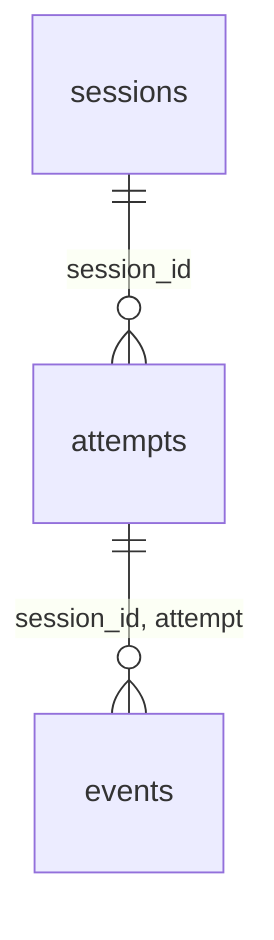

# Diccionario de datos

Este documento define cada archivo y columna. Para entender **qué representa** el dataset (cómo se generan las filas, un intento explicado fila a fila, tipos de variables y precauciones de análisis), lea primero la [guía del dataset](guia-datos.md).

> Formato de datos **1.1** (`data_format_version`). Implementado en las Fases 2 y 3 (ver [cambios de formato](#9-cambios-de-formato)). Las columnas se definen en `src/telemetry/schema.js`; una prueba automática verifica que todas estén documentadas aquí.

## 1. Archivos

El botón **Descargar datos** (pantalla de inicio o de resultados) entrega un ZIP `data-dash-AAAAMMDD-HHMM.zip` con todas las partidas guardadas en el navegador:

| Archivo | Granularidad | Clave |
|---|---|---|
| `sessions.csv` | Una fila por sesión (un nivel jugado desde «Comenzar» hasta salir) | `session_id` |
| `attempts.csv` | Una fila por intento (desde el inicio hasta el choque, la meta, el reinicio o la salida) | `session_id` + `attempt` |
| `events.csv` | Eventos y estados muestreados de cada intento | `session_id` + `attempt` + orden de fila |
| `experiment.json` | Metadatos: versión del motor, constantes físicas, muestreo, recuentos | — |
| `LEEME.txt` | Descripción breve para quien abre el ZIP | — |



### Convenciones

| Aspecto | Valor |
|---|---|
| Codificación | UTF-8 **con BOM** (Excel reconoce las tildes). En pandas: `encoding="utf-8-sig"` |
| Separador / decimal | Coma / punto |
| Fin de línea | `\r\n` (RFC 4180) |
| Booleanos | `1` / `0` |
| Vacío | Campo vacío = no aplica (p. ej. `collision_obstacle_id` en un intento completado) |
| Fechas | ISO 8601 en UTC, p. ej. `2026-11-23T15:04:05.123Z` |
| Distancias | Unidades de mundo (u). El cubo del jugador mide 1 × 1 u |
| Tiempo simulado | `tick` = pasos de 1/120 s; `time_s = tick / 120` |
| Precisión | Decimales redondeados a 4 cifras |

Los tiempos de `events.csv` son **simulados**, no de reloj: dos intentos con las mismas acciones en el mismo nivel producen filas idénticas. Solo `started_at` y `ended_at` son fechas reales.

### Ejemplo en pandas

```python
import pandas as pd

sessions = pd.read_csv("sessions.csv", encoding="utf-8-sig")
attempts = pd.read_csv("attempts.csv", encoding="utf-8-sig")
events = pd.read_csv("events.csv", encoding="utf-8-sig")

states = events[events.record_type == "state"]
jumps = events[events.event_type == "jump"]
attempts.groupby("level_id").outcome.value_counts()
```

## 2. `sessions.csv`

| Columna | Tipo | Unidad | Descripción | Ejemplo |
|---|---|---|---|---|
| `session_id` | texto | — | Identificador aleatorio de la sesión (12 hex) | `3fa9c01b77e2` |
| `player_id` | texto | — | Seudónimo aleatorio y estable de este navegador; **no** identifica a la persona | `a1b2c3d4e5f6` |
| `mode` | texto | — | Quién decide: `human` (persona), `rule` (agente de reglas incluido en el juego) o `student` (agente programado por el estudiante en `agents/StudentAgent.js`) | `rule` |
| `agent_name` | texto | — | Nombre del agente (vacío si `mode = human`) | `RuleAgent` |
| `agent_version` | texto | — | Versión del agente, declarada por quien lo programó. Distingue estrategias distintas del mismo agente | `1.0.0` |
| `agent_params` | texto (JSON) | — | Parámetros del agente en JSON (vacío si `mode = human`). En pandas: `sessions.agent_params.dropna().map(json.loads)` | `{"spike":0.15,"block":2.5,"platform":1.3}` |
| `started_at` | fecha | UTC | Inicio de la sesión | `2026-11-23T15:00:00.000Z` |
| `ended_at` | fecha | UTC | Cierre del último intento guardado | `2026-11-23T15:06:12.400Z` |
| `level_id` | texto | — | Nivel: `easy`, `medium`, `hard` o `proc-<dificultad>-<semilla>` | `easy` |
| `level_name` | texto | — | Nombre visible del nivel | `Neón Inicial` |
| `level_source` | texto | — | `preset` (predefinido) o `procedural` | `preset` |
| `difficulty` | texto | — | `easy`, `medium` o `hard` | `easy` |
| `seed` | entero | — | Semilla del nivel | `1001` |
| `speed` | real | u/s | Velocidad horizontal constante | `8.5` |
| `level_length` | real | u | Posición x de la meta | `224` |
| `obstacles_total` | entero | — | Obstáculos del nivel | `30` |
| `attempts` | entero | — | Intentos guardados en la sesión | `7` |
| `completed` | 0/1 | — | 1 si algún intento llegó a la meta | `1` |
| `best_progress` | real | % | Mejor progreso de la sesión (0–100) | `100` |
| `best_score` | entero | puntos | Mejor puntuación de la sesión | `6240` |
| `engine_version` | texto | — | Versión del motor de simulación | `0.1.0` |
| `data_format_version` | texto | — | Versión de este formato de datos | `1.0` |
| `sample_every_ticks` | entero | pasos | Intervalo de muestreo de estados (12 = 10 Hz) | `12` |

## 3. `attempts.csv`

| Columna | Tipo | Unidad | Descripción | Ejemplo |
|---|---|---|---|---|
| `session_id` | texto | — | Sesión a la que pertenece | `3fa9c01b77e2` |
| `attempt` | entero | — | Número de intento dentro de la sesión (desde 1) | `3` |
| `mode` | texto | — | Modalidad: `human`, `rule` o `student` (repetida para facilitar el análisis) | `human` |
| `level_id` | texto | — | Nivel (repetido) | `easy` |
| `seed` | entero | — | Semilla (repetida) | `1001` |
| `started_at` | fecha | UTC | Inicio del intento | `2026-11-23T15:01:10.020Z` |
| `ended_at` | fecha | UTC | Fin del intento | `2026-11-23T15:01:21.900Z` |
| `outcome` | texto | — | Resultado (ver §5) | `collision` |
| `ticks` | entero | pasos | Pasos simulados del intento | `185` |
| `duration_s` | real | s | Duración simulada = `ticks / 120` | `1.5417` |
| `distance` | real | u | Distancia recorrida (x del jugador al terminar) | `13.1042` |
| `progress` | real | % | Progreso alcanzado (0–100) | `5.8501` |
| `score` | entero | puntos | 10 × distancia + 100 × obstáculos superados + 1000 si completa | `131` |
| `jumps` | entero | — | Saltos realizados | `2` |
| `obstacles_passed` | entero | — | Obstáculos superados | `0` |
| `obstacles_total` | entero | — | Obstáculos del nivel | `30` |
| `collision_obstacle_id` | texto | — | Obstáculo del choque (vacío si no chocó) | `easy-000` |
| `collision_obstacle_type` | texto | — | `spike`, `block` o `platform` (vacío si no chocó) | `spike` |
| `collision_x` | real | u | Posición x del jugador al chocar (vacío si no chocó) | `13.1042` |

## 4. `events.csv`

Cada fila describe el estado del jugador **después** del paso indicado en `tick`. Hay dos tipos de fila:

- `record_type = event`: algo ocurrió en ese paso (ver `event_type`).
- `record_type = state`: observación periódica, cada `sample_every_ticks` pasos, aunque no ocurra nada. Útil para series temporales y para entrenar clasificadores.

Dentro de un mismo `tick`, el orden es: `decision`, eventos del motor, `state`.

| Columna | Tipo | Unidad | Descripción | Ejemplo |
|---|---|---|---|---|
| `session_id` | texto | — | Sesión | `3fa9c01b77e2` |
| `attempt` | entero | — | Intento | `3` |
| `tick` | entero | pasos | Paso de simulación (0 = antes del primer paso) | `240` |
| `time_s` | real | s | Tiempo simulado = `tick / 120` | `2` |
| `record_type` | texto | — | `event` o `state` | `state` |
| `event_type` | texto | — | Tipo de evento (ver tabla siguiente); vacío en filas `state` | `jump` |
| `action` | texto | — | Acción aplicada en ese paso: `JUMP` o `WAIT`, decidida por la persona o por el agente. Vacío en `attempt_start` y `attempt_end` | `WAIT` |
| `player_x` | real | u | Borde izquierdo del cubo | `17` |
| `player_y` | real | u | Borde inferior del cubo (0 = suelo) | `1.2385` |
| `player_vy` | real | u/s | Velocidad vertical (positiva hacia arriba) | `-4.5` |
| `grounded` | 0/1 | — | 1 si está apoyado en el suelo o en un sólido | `0` |
| `progress` | real | % | Progreso (0–100) | `7.69` |
| `score` | entero | puntos | Puntuación acumulada | `370` |
| `obstacles_passed` | entero | — | Obstáculos superados hasta ese momento | `2` |
| `jumps` | entero | — | Saltos realizados hasta ese momento | `2` |
| `next_obstacle_id` | texto | — | Siguiente obstáculo aún no superado (vacío si no quedan) | `easy-002` |
| `next_obstacle_type` | texto | — | `spike`, `block` o `platform` | `block` |
| `next_obstacle_dx` | real | u | Distancia horizontal del frente del cubo al obstáculo: `x_obstáculo − (player_x + 1)`. Negativa si el cubo ya está encima | `3.25` |
| `next_obstacle_y` | real | u | Altura de la base del obstáculo (0 = apoyado en el suelo) | `0` |
| `next_obstacle_w` | real | u | Ancho del obstáculo | `1` |
| `next_obstacle_h` | real | u | Alto del obstáculo | `1` |
| `event_obstacle_id` | texto | — | Obstáculo del evento (`land`, `obstacle_passed`, `collision`) | `easy-001` |
| `event_obstacle_type` | texto | — | Tipo del obstáculo del evento | `spike` |
| `outcome` | texto | — | Solo en `attempt_end`: resultado del intento (ver §5) | `collision` |

### Tipos de evento (`event_type`)

| Valor | Cuándo se registra |
|---|---|
| `attempt_start` | Al comenzar el intento (`tick` = 0) |
| `decision` | Cuando la acción cambia respecto al paso anterior (`WAIT`→`JUMP` al pulsar, `JUMP`→`WAIT` al soltar). La columna `action` indica la nueva acción |
| `jump` | El cubo despega. Mantener pulsado genera un `jump` en cada aterrizaje, pero una sola `decision` |
| `land` | El cubo aterriza. `event_obstacle_id` vacío = suelo; si no, el bloque o plataforma |
| `obstacle_passed` | El cubo supera por completo un obstáculo |
| `collision` | El cubo choca y el intento termina |
| `complete` | El cubo llega a la meta |
| `attempt_end` | Cierre del intento, con su `outcome`. Siempre es la última fila del intento |

## 5. Resultados de un intento (`outcome`)

| Valor | Significado |
|---|---|
| `completed` | Llegó a la meta |
| `collision` | Chocó con un obstáculo |
| `restart` | El jugador reinició el intento antes de terminarlo (tecla `R` o menú de pausa) |
| `quit` | El jugador terminó la sesión o volvió al menú con el intento en curso, o el agente falló (lanzó un error o devolvió una acción inválida) |

## 6. `experiment.json`

| Campo | Descripción |
|---|---|
| `data_format_version`, `engine_version` | Versiones del formato y del motor |
| `exported_at` | Fecha de la exportación (UTC) |
| `physics` | Constantes físicas: `TICK_RATE`, `GRAVITY`, `JUMP_VELOCITY`, `MAX_FALL_SPEED`, etc. |
| `units` | Unidades de distancia, tiempo y velocidad |
| `telemetry` | Frecuencia de simulación, muestreo, tipos de evento y resultados posibles |
| `counts` | Número de sesiones, intentos y filas de eventos |
| `files` | Columnas de cada CSV, en orden |

## 7. Derivar etiquetas (ETL)

Los datos crudos **no** incluyen etiquetas a futuro, para no mezclar observación y resultado (ADR-0005). Ejemplo: «¿choca en los próximos *H* pasos?» con un horizonte explícito:

```python
H = 60  # 0,5 s
end = events[events.event_type == "attempt_end"][["session_id", "attempt", "tick", "outcome"]]
end = end.rename(columns={"tick": "end_tick"})
s = states.merge(end, on=["session_id", "attempt"])
s["crash_within_H"] = ((s.outcome == "collision") & (s.end_tick - s.tick <= H)).astype(int)
```

Declare siempre el valor de *H* en el informe: cambiarlo cambia el problema.

## 8. Privacidad y almacenamiento

- No se registran nombres, correos ni datos del dispositivo. `player_id` y `session_id` son aleatorios.
- Los datos se guardan solo en el navegador (IndexedDB) y no se envían a ningún servidor (ADR-0007).
- Se guardan al terminar cada intento. Si se cierra la pestaña a mitad de un intento, ese intento se pierde.
- En navegación privada se usan solo la memoria de la pestaña y un aviso lo indica.
- **Borrar datos** elimina todo lo guardado en ese navegador.

## 9. Cambios de formato

| Versión | Cambio |
|---|---|
| 1.0 | Formato inicial (Fase 2) |
| 1.1 | `sessions.csv` añade `agent_name`, `agent_version` y `agent_params`; `mode` admite `rule` y `student` (Fase 3). Las sesiones guardadas con 1.0 quedan con esas columnas vacías |
