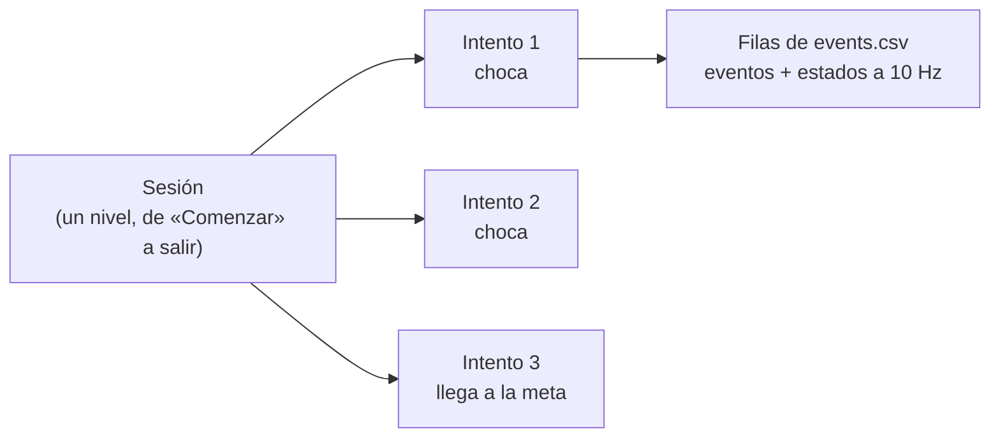
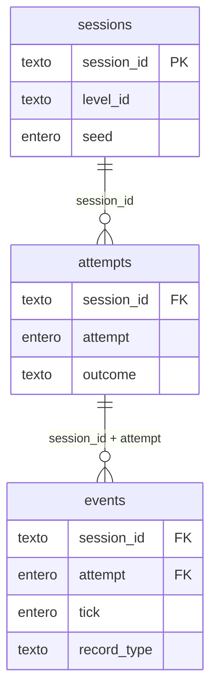

# Guía del dataset de Data Dash

Esta guía explica **qué representa** el conjunto de datos que se descarga desde el juego: de dónde salen las filas, qué es cada tabla, cómo se relacionan, qué tipo de variable es cada columna y qué precauciones tomar al analizarlo. La definición exacta de cada columna está en el [diccionario de datos](diccionario-datos.md).

> Formato de datos **1.1** (columna `data_format_version`). Las partidas pueden ser de personas (`mode = human`) o de agentes (`rule`, `student`).

## 1. ¿Qué es este dataset?

Data Dash es un juego en el que un cubo avanza solo a velocidad constante y quien juega solo toma **una decisión**: saltar o no saltar. Si el cubo toca un obstáculo, el intento termina; si llega a la meta, el nivel se completa.

Quien decide puede ser una persona o un programa (agente):

| `mode` | Quién decide |
|---|---|
| `human` | Una persona, con teclado, ratón o pantalla táctil |
| `rule` | `RuleAgent`, un agente de reglas incluido en el juego: salta cuando el obstáculo está a cierta distancia (umbrales configurables) |
| `student` | El agente que programa cada estudiante en `agents/StudentAgent.js` |

Cada vez que alguien juega, el juego registra **qué vio el jugador, qué decidió y qué pasó después**. El resultado es un dataset de comportamiento que sirve para:

- **Analítica descriptiva:** ¿cuántos intentos se necesitan para completar un nivel? ¿Dónde choca la gente?
- **Visualización:** trayectorias del cubo, mapas de choques a lo largo del nivel, curvas de aprendizaje.
- **Estadística inferencial:** ¿mejora el progreso con la práctica? ¿Es más difícil un pincho que un bloque?
- **Aprendizaje automático:** predecir si el cubo va a chocar o cuándo conviene saltar a partir del estado.

### El proceso que genera los datos

El juego es **determinista**: el mismo nivel con las mismas acciones da siempre el mismo resultado. La única fuente de variación es **quien juega** (cuándo pulsa y cuándo suelta). Por eso las diferencias entre intentos se deben a las decisiones, no al azar. Un agente que no aprende ni usa azar repite exactamente el mismo intento una y otra vez.

El juego simula **120 pasos por segundo** (cada paso es un `tick`). En cada paso:

1. Se obtiene la acción: `JUMP` (tecla pulsada) o `WAIT` (no pulsada). Si juega un agente, la decide su método `decide()`.
2. El motor mueve el cubo (velocidad horizontal fija, gravedad y salto).
3. El motor detecta lo que ocurrió: despegue, aterrizaje, obstáculo superado, choque o llegada a la meta.

Registrar los 120 pasos de cada segundo generaría archivos enormes y muy repetitivos. Por eso el juego guarda **dos tipos de fila**:

- **Eventos:** una fila cada vez que **algo ocurre** (un salto, un aterrizaje, un choque, un cambio de decisión).
- **Estados muestreados:** una «fotografía» del cubo **cada 12 pasos (10 veces por segundo)**, aunque no ocurra nada.

## 2. Jerarquía: sesión → intento → fila de evento



| Concepto | Qué es | Dónde está |
|---|---|---|
| **Sesión** | Un nivel jugado desde que se pulsa «Comenzar» hasta que se sale a los resultados o al menú. Una sesión tiene uno o más intentos. | `sessions.csv` (una fila por sesión) |
| **Intento** | Un recorrido del nivel desde la salida hasta que el cubo choca, llega a la meta o el jugador reinicia o sale. Tras un choque empieza otro intento automáticamente. | `attempts.csv` (una fila por intento) |
| **Fila de evento o estado** | Lo que pasó en un instante concreto de un intento. | `events.csv` (muchas filas por intento) |

El ZIP descargado contiene **todas** las sesiones guardadas en ese navegador, no solo la última.

## 3. Las tablas: unidad de observación y para qué sirven

| Archivo | Una fila es… | Tamaño típico | Úselo para |
|---|---|---|---|
| `sessions.csv` | Una sesión de juego en un nivel | Pocas filas | Contexto: nivel, dificultad, semilla, número de intentos, si se completó, mejor resultado |
| `attempts.csv` | Un intento | Decenas de filas | Rendimiento: resultado, duración, distancia, progreso, puntos, saltos, dónde y contra qué chocó |
| `events.csv` | Un evento o un estado muestreado dentro de un intento | Cientos o miles de filas (≈ 10 por segundo jugado) | Comportamiento detallado: trayectorias, momento de cada salto, distancia al obstáculo al decidir |
| `experiment.json` | — (metadatos) | Un archivo | Constantes físicas, versión del motor, frecuencia de muestreo, lista de columnas |
| `LEEME.txt` | — | Un archivo | Resumen rápido de los archivos |

**Claves para unir las tablas:**



- `attempt` es el número del intento **dentro de su sesión** (1, 2, 3…). Por sí solo no identifica un intento: siempre hay que usar el par `session_id` + `attempt`.
- `attempts.csv` repite `mode`, `level_id` y `seed` para poder analizarla sin unirla con `sessions.csv`.

## 4. Un intento, fila a fila

Las filas siguientes las generó el motor del juego en el nivel *Neón Inicial* (`easy`). Se omiten algunas columnas.

**En `attempts.csv`**, el intento se resume en una fila:

| session_id | attempt | outcome | ticks | duration_s | distance | progress | score | jumps | obstacles_passed | collision_obstacle_id | collision_obstacle_type |
|---|---|---|---|---|---|---|---|---|---|---|---|
| 3fa9c01b77e2 | 1 | collision | 466 | 3.8833 | 33.0083 | 14.7359 | 530 | 3 | 2 | easy-002 | block |

Se lee así: el cubo avanzó durante 3,88 s simulados, recorrió 33 unidades (el 14,7 % del nivel), saltó 3 veces, superó 2 obstáculos y chocó contra el tercero, un bloque.

**En `events.csv`**, el mismo intento tiene 53 filas. Algunas de ellas:

| tick | time_s | record_type | event_type | action | player_x | player_y | player_vy | grounded | score | next_obstacle_id | next_obstacle_dx |
|---|---|---|---|---|---|---|---|---|---|---|---|
| 0 | 0 | event | attempt_start | | 0 | 0 | 0 | 1 | 0 | easy-000 | 13 |
| 12 | 0.1 | state | | WAIT | 0.85 | 0 | 0 | 1 | 8 | easy-000 | 12.15 |
| 168 | 1.4 | state | | WAIT | 11.9 | 0 | 0 | 1 | 118 | easy-000 | 1.1 |
| 179 | 1.4917 | event | decision | JUMP | 12.6792 | 0.1563 | 18.75 | 0 | 126 | easy-000 | 0.3208 |
| 179 | 1.4917 | event | jump | JUMP | 12.6792 | 0.1563 | 18.75 | 0 | 126 | easy-000 | 0.3208 |
| 192 | 1.6 | event | decision | WAIT | 13.6 | 1.6188 | 9 | 0 | 135 | easy-000 | -0.6 |
| 204 | 1.7 | state | | WAIT | 14.45 | 2.0313 | 0 | 0 | 144 | easy-000 | -1.45 |
| 212 | 1.7667 | event | obstacle_passed | WAIT | 15.0167 | 1.8062 | -6 | 0 | 250 | easy-001 | 7.9833 |
| 229 | 1.9083 | event | land | WAIT | 16.2208 | 0 | 0 | 1 | 262 | easy-001 | 6.7792 |
| … | | | | | | | | | | | |
| 462 | 3.85 | event | jump | JUMP | 32.725 | 0.1563 | 18.75 | 0 | 527 | easy-002 | 0.275 |
| 466 | 3.8833 | event | collision | JUMP | 33.0083 | 0.7188 | 15.75 | 0 | 530 | easy-002 | -0.0083 |
| 466 | 3.8833 | event | attempt_end | | 33.0083 | 0.7188 | 15.75 | 0 | 530 | easy-002 | -0.0083 |

Lo que cuentan estas filas:

- **Ticks 0 a 168:** el cubo corre por el suelo (`player_y = 0`, `grounded = 1`) y la distancia al primer pincho (`next_obstacle_dx`) baja de 13 a 1,1 unidades. Cada 12 pasos hay una fila `state`.
- **Tick 179:** el jugador pulsa (`decision` → `JUMP`) y el cubo despega en el mismo paso (`jump`). Las dos filas comparten tick y valores, porque describen el mismo instante. En ese momento faltaban 0,32 unidades para el pincho: ese dato es la base de cualquier análisis sobre «cuándo saltar».
- **Tick 192:** el jugador suelta (`decision` → `WAIT`). `next_obstacle_dx` es negativo porque el cubo ya está encima del pincho.
- **Tick 212:** el cubo deja atrás el pincho (`obstacle_passed`). La puntuación salta a 250: 10 por cada unidad recorrida más 100 por el obstáculo superado y el «siguiente obstáculo» cambia a `easy-001`.
- **Tick 229:** el cubo aterriza en el suelo (`land`, `player_vy` vuelve a 0).
- **Tick 466:** el cubo choca con el bloque `easy-002` y el intento se cierra (`attempt_end`, con `outcome = collision`). Siempre es la última fila del intento y coincide con la fila de `attempts.csv`.

## 5. Tipos de variables

Clasificar bien cada columna evita errores como promediar un identificador o tratar la dificultad como texto sin orden.

| Tipo | Columnas | Cómo tratarlas |
|---|---|---|
| **Identificadores** | `session_id`, `player_id`, `attempt` (dentro de la sesión), `next_obstacle_id`, `event_obstacle_id`, `collision_obstacle_id` | Sirven para agrupar y unir, nunca para calcular. `attempt` es un número, pero su orden sí tiene sentido (1.º, 2.º… intento) |
| **Categóricas nominales** | `mode`, `agent_name`, `agent_version`, `level_id`, `level_name`, `level_source`, `record_type`, `event_type`, `action`, `outcome`, `*_obstacle_type` | Conteos, proporciones, tablas de contingencia, colores en gráficos. `agent_version` es texto aunque parezca un número (`1.10` ≠ `1.1`) |
| **Texto estructurado (JSON)** | `agent_params` | Conviértalo en columnas: `pd.json_normalize(sessions.agent_params.dropna().map(json.loads))` |
| **Categórica ordinal** | `difficulty` (`easy` < `medium` < `hard`) | Ordénela explícitamente (en pandas, `pd.Categorical(..., ordered=True)`) |
| **Booleanas (0/1)** | `grounded`, `completed` | Su media es una proporción: la media de `completed` es la tasa de sesiones completadas |
| **Numéricas discretas (conteos)** | `ticks`, `tick`, `jumps`, `obstacles_passed`, `obstacles_total`, `attempts`, `score`, `best_score` | Sumas, medias, distribuciones. `score` es una variable **derivada** (ver §6) |
| **Numéricas continuas** | `duration_s`, `time_s`, `distance`, `progress`, `best_progress`, `player_x`, `player_y`, `player_vy`, `next_obstacle_dx`, `next_obstacle_y`, `next_obstacle_w`, `next_obstacle_h`, `collision_x`, `speed`, `level_length` | Medias, desviaciones, histogramas, correlaciones, regresión |
| **Fechas reales** | `started_at`, `ended_at` | ISO 8601 en UTC. En pandas: `pd.to_datetime(...)`. Úselas para ordenar, no para medir el juego (ver §6) |
| **Parámetros del nivel** | `seed`, `speed`, `level_length`, `obstacles_total` | Constantes dentro de un nivel: describen el contexto, no el comportamiento |
| **Metadatos de versión** | `engine_version`, `data_format_version`, `sample_every_ticks` | Compruebe que sean iguales antes de combinar datos |

### Unidades

- **Distancias** en unidades de mundo (u). El cubo mide 1 × 1 u. El nivel fácil mide 224 u.
- **Tiempo simulado** en pasos (`tick`) o segundos (`time_s = tick / 120`).
- **Velocidad vertical** (`player_vy`) en u/s, positiva hacia arriba. Al despegar vale 18,75 u/s y va bajando por la gravedad.
- **Progreso** en porcentaje del nivel (0–100): `player_x / level_length × 100`.
- **Puntuación** = 10 × distancia + 100 × obstáculos superados + 1000 si completa el nivel.

## 6. Precauciones al analizar

| Situación | Por qué importa | Qué hacer |
|---|---|---|
| `events.csv` mezcla dos tipos de fila | Las filas `state` se toman a intervalos regulares; las `event`, solo cuando algo ocurre. Juntarlas sesga cualquier promedio temporal | Filtre por `record_type` antes de calcular: `state` para series de tiempo, `event` para contar sucesos |
| Varias filas con el mismo `tick` | Un mismo instante puede generar `decision`, `jump` y `state` a la vez | No cuente filas para medir tiempo; use `tick` o `time_s` |
| Muestreo a 10 Hz | Entre dos filas `state` pasan 12 pasos y puede ocurrir algo que no aparece en ellas | Para el momento exacto de un salto o choque, use las filas `event` |
| `restart` y `quit` no son fracasos | Son intentos que el jugador interrumpió; no los terminó el juego | Al calcular tasas de éxito o de choque, decida explícitamente si los excluye y dígalo en el informe |
| Mantener pulsado | Si se mantiene la tecla, hay un `jump` en cada aterrizaje pero una sola `decision` | Para estudiar decisiones, use `decision`; para estudiar el movimiento, use `jump` |
| Personas y agentes mezclados | Un agente no se cansa ni aprende con la práctica; una persona sí | Separe o compare por `mode` (y por `agent_name` + `agent_version`); no mezcle sus intentos al estimar «el desempeño» |
| Agentes deterministas | Un agente sin memoria ni azar repite **exactamente** el mismo intento; tras un choque el juego reinicia solo, así que pueden acumularse muchos intentos idénticos | Esos intentos no son muestras independientes: cuente uno por combinación de agente, versión, parámetros y nivel, o compare en niveles procedurales distintos (semillas) |
| `player_id` identifica un **navegador**, no una persona | Dos personas en el mismo computador comparten seudónimo; una persona en dos navegadores tiene dos | No lo interprete como «estudiante» sin verificarlo |
| El ZIP es acumulativo | Cada descarga incluye todo lo guardado en el navegador. Dos ZIP del mismo navegador repiten filas | Al combinar archivos, elimine duplicados por `session_id` + `attempt` (y `tick` en eventos), o use **Borrar datos** antes de cada práctica |
| Niveles distintos | Un 50 % de progreso no cuesta lo mismo en el nivel fácil que en el difícil | Compare dentro del mismo `level_id` y `seed`, o incluya el nivel como variable |
| Tiempo simulado frente a tiempo real | `duration_s` mide el juego; `ended_at − started_at` es tiempo de reloj y puede incluir pausas y animaciones | Use `duration_s` y `time_s` para medir el desempeño |
| Variables derivadas | `score` se calcula a partir de `distance` y `obstacles_passed`; `progress` a partir de `distance` | No las use juntas como si fueran independientes (están casi perfectamente correlacionadas) |
| Intentos no independientes | El jugador aprende: el intento 10 depende de los 9 anteriores | Tenga en cuenta el orden (`attempt`) y la sesión al aplicar pruebas que suponen independencia |
| Sesgo de supervivencia | Las posiciones avanzadas del nivel solo aparecen en los intentos que llegaron lejos | Al comparar zonas del nivel, normalice por cuántos intentos llegaron a cada zona |
| Campos vacíos | Vacío significa «no aplica» (p. ej. `collision_x` en un intento completado), no «dato perdido» | No los impute; filtre según el caso |
| Versiones | Un cambio de `engine_version` puede cambiar la física y hacer incomparables los resultados | No mezcle versiones sin comprobarlo |

## 7. Cargar y unir los datos

**Python (pandas):**

```python
import pandas as pd

sessions = pd.read_csv("sessions.csv", encoding="utf-8-sig")
attempts = pd.read_csv("attempts.csv", encoding="utf-8-sig")
events = pd.read_csv("events.csv", encoding="utf-8-sig")

# Separar los dos tipos de fila
states = events[events.record_type == "state"]
evts = events[events.record_type == "event"]

# Añadir el contexto del nivel a cada intento
att = attempts.merge(sessions[["session_id", "level_name", "difficulty"]], on="session_id")

# Resultados por nivel
att.groupby("level_name").outcome.value_counts(normalize=True)

# ¿A qué distancia del obstáculo se decide saltar?
evts[(evts.event_type == "decision") & (evts.action == "JUMP")].next_obstacle_dx.describe()
```

**Excel:** abra cada CSV con doble clic (UTF-8 con BOM, separador coma). Para unir tablas use `BUSCARX` por `session_id`, o el modelo de datos de Power Pivot.

**Power BI:** *Obtener datos → Texto/CSV* para cada archivo y, en la vista de modelo, relacione `sessions[session_id]` → `attempts[session_id]`. Para `events`, cree en las dos tablas una columna `session_id & "-" & attempt` y relaciónelas por ella.

## 8. Preguntas para explorar

| Nivel | Preguntas |
|---|---|
| Descriptivo | ¿Cuántos intentos se necesitan, en promedio, para completar cada nivel? ¿Qué porcentaje de intentos termina en choque? ¿Qué obstáculo provoca más choques? |
| Visualización | Gráfico de `player_y` frente a `player_x` de un intento (la trayectoria). Histograma de `collision_x` (dónde se choca). Curva de `progress` frente al número de intento |
| Comparación | ¿Chocamos más con pinchos (`spike`), bloques (`block`) o plataformas (`platform`)? ¿Cambia la distancia a la que se salta según el tipo de obstáculo? |
| Inferencia | ¿Mejora significativamente el progreso entre los primeros y los últimos intentos? ¿Hay diferencias entre niveles? |
| Personas frente a agentes | ¿Llega `RuleAgent` más lejos que las personas en el nivel fácil? ¿Saltan las personas antes o después que el agente (`next_obstacle_dx` en las filas `decision` con `action = JUMP`)? ¿Cómo cambia el progreso del agente al variar sus umbrales (`agent_params`)? |
| Aprendizaje automático | Con las filas `state`, ¿se puede predecir si el cubo chocará en los próximos 0,5 s? ¿Y la acción (`JUMP` o `WAIT`) a partir de `next_obstacle_dx` y `next_obstacle_type`? |

Para crear la variable objetivo «choca en los próximos *H* pasos», vea el ejemplo de la sección *Derivar etiquetas* del [diccionario de datos](diccionario-datos.md). El dataset no trae esa etiqueta a propósito: el horizonte *H* lo elige quien analiza y debe declararlo.

## 9. Glosario

| Término | Significado |
|---|---|
| Tick (paso) | Unidad de tiempo de la simulación: 1/120 s |
| Unidad (u) | Unidad de distancia del juego; el cubo mide 1 u de lado |
| Sesión | Un nivel jugado desde «Comenzar» hasta salir; contiene intentos |
| Intento | Un recorrido desde la salida hasta el choque, la meta, el reinicio o la salida |
| Evento | Algo que ocurre en un paso concreto: salto, aterrizaje, obstáculo superado, choque, meta, cambio de decisión |
| Estado muestreado | Fotografía periódica (10 por segundo) de la posición y velocidad del cubo y del siguiente obstáculo |
| Siguiente obstáculo | El primer obstáculo que el cubo aún no ha superado; `next_obstacle_dx` es la distancia horizontal hasta él |
| Semilla (`seed`) | Número que define la forma de un nivel; con la misma semilla el nivel es idéntico |
| Determinista | Mismas acciones en el mismo nivel ⇒ mismas filas en `events.csv` |
| Agente | Programa que decide en lugar de una persona: recibe una observación en cada paso y devuelve `JUMP` o `WAIT` |
| Seudónimo | Identificador aleatorio (`player_id`, `session_id`) que no contiene datos personales |
